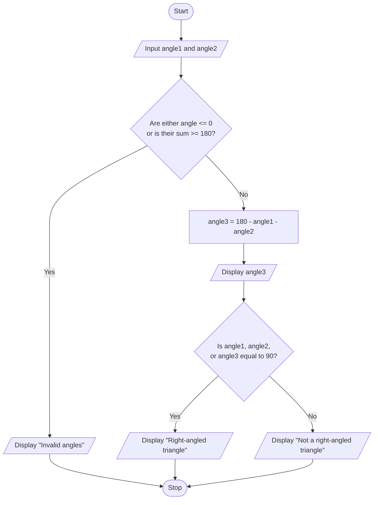

# COS 102 C++ Assessment

This folder contains two separate C++ programs, pseudocode, and flowcharts.

## Files

- `question1.cpp` — checks whether a triangle is right-angled using two input angles.
- `question2.cpp` — checks whether an entered integer is a palindrome.
- `README.md` — pseudocode, flowcharts, and brief explanations.

## Question 1: Right-angled triangle

### How it works

A triangle's three interior angles add up to 180 degrees. The program accepts two angles, calculates the third angle, and checks whether any of the three angles is exactly 90 degrees. It also rejects invalid inputs.

### Pseudocode

```text
START
    INPUT angle1
    INPUT angle2

    IF angle1 <= 0 OR angle2 <= 0 OR angle1 + angle2 >= 180 THEN
        DISPLAY "Invalid angles"
    ELSE
        angle3 = 180 - (angle1 + angle2)

        DISPLAY angle3

        IF angle1 = 90 OR angle2 = 90 OR angle3 = 90 THEN
            DISPLAY "Right-angled triangle"
        ELSE
            DISPLAY "Not a right-angled triangle"
        ENDIF
    ENDIF
STOP
```

### Flowchart



## Question 2: Palindrome number

### How it works

A palindrome reads the same from left to right and right to left. For example, `121` and `4554` are palindromes, while `123` is not. The program compares the first and last characters, then moves inwards. Negative integers are treated as not being palindromes.

### Pseudocode

```text
START
    INPUT number

    IF number begins with "-" THEN
        DISPLAY "Not a palindrome"
    ELSE
        left = 0
        right = length(number) - 1
        isPalindrome = TRUE

        WHILE left < right
            IF number[left] is not equal to number[right] THEN
                isPalindrome = FALSE
                EXIT WHILE
            ENDIF

            left = left + 1
            right = right - 1
        ENDWHILE

        IF isPalindrome = TRUE THEN
            DISPLAY "Palindrome"
        ELSE
            DISPLAY "Not a palindrome"
        ENDIF
    ENDIF
STOP
```

### Flowchart

```mermaid
flowchart TD
    A([Start]) --> B[/Input integer/]
    B --> C{Does the number<br/>begin with "-"?}
    C -- Yes --> D[/Display "Not a palindrome"/]
    D --> Z([Stop])
    C -- No --> E[Set left = 0<br/>Set right = last position<br/>Set isPalindrome = TRUE]
    E --> F{Is left < right?}
    F -- No --> G{Is isPalindrome TRUE?}
    F -- Yes --> H{Do the characters<br/>at left and right match?}
    H -- No --> I[Set isPalindrome = FALSE]
    I --> G
    H -- Yes --> J[Move left one step right<br/>Move right one step left]
    J --> F
    G -- Yes --> K[/Display "Palindrome"/]
    G -- No --> L[/Display "Not a palindrome"/]
    K --> Z
    L --> Z
```

## How to compile and run

Using a C++ compiler such as `g++`, open a terminal in this folder and run:

```bash
g++ question1.cpp -o question1
./question1
```

For the second program:

```bash
g++ question2.cpp -o question2
./question2
```

On Windows, run the generated programs as `question1.exe` and `question2.exe`.

## Sample tests

### Question 1

- Input: `90` and `45` → third angle is `45`; right-angled.
- Input: `60` and `60` → third angle is `60`; not right-angled.
- Input: `100` and `90` → invalid, because the two angles already total 190 degrees.

### Question 2

- Input: `121` → palindrome.
- Input: `4554` → palindrome.
- Input: `123` → not a palindrome.
- Input: `-121` → not a palindrome.
